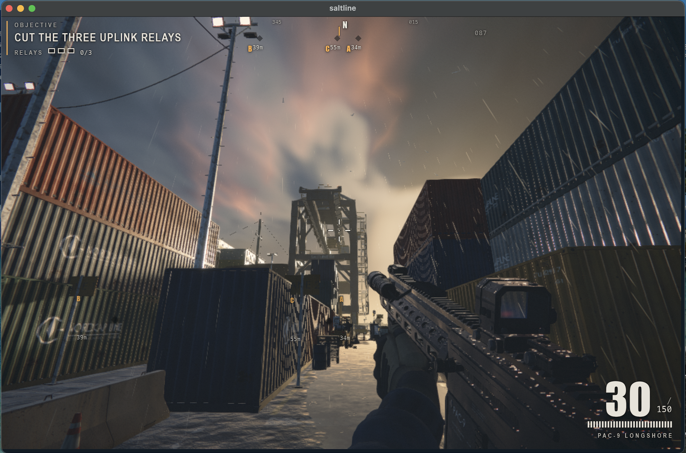

# Saltline · xbintsc

> A single-prompt browser FPS, now a native desktop app.

[](https://github.com/zy445566/xbintsc)
[](#license)

**English** | [简体中文](README.md)



**Saltline** is a single-level first-person shooter set in a rain-soaked container terminal. As the only breacher left in the Port Authority unit, you cut the Harbormaster's three uplink relays and reach the boat at the south quay while Gulls (drones) and Hounds (walkers) hunt you.

This repository is an **unofficial native desktop port built with [xbintsc](https://github.com/zy445566/xbintsc)**. It is not Electron and not a WebView shell: the window, DOM/CSS, WebGL 2, Canvas 2D and WebAudio all come from xbintsc's `gui` extension, and the whole game — 66 ES modules including three.js r180 — is AOT-compiled into the executable. There is no browser and no JavaScript engine at runtime.

`assets/` is build input only. The result is one self-contained executable of about 24 MB; every mesh, texture and sound is generated at startup.

## The game

- **Objective**: three relays — A (yard), B (shed) and C (quay). Hold `E` for 2.4 seconds next to one to cut it; each cut triggers another wave of machines. Once all three are dark, the objective becomes "Get to the boat" and the extraction boat waits at the south quay.
- **Enemies**: Gulls are flying drones, Hounds are ground walkers; a Hound's head is a weak point, and weak-point hits and kills each get their own HUD feedback.
- **Weapon**: the PAC-9 Longshore — 30-round magazine, 150 rounds in reserve, 720 RPM — with aim-down-sights, reload, melee and moving fire.
- **World**: an 80 × 60 m container yard with gantry cranes, a freighter, puddle reflections, rain, volumetric mist and a dusk sky. There are no external model or texture files.
- **Audio**: everything is synthesized with WebAudio; the music intensity follows the fight.
- **HUD and flow**: compass objective markers, relay counter, vitals, ammo, kill feed and radio subtitles, plus title, pause, death and debrief screens. The debrief rates the run from `Messy` to `Surgical` based on time, accuracy and retries.
- **Settings**: graphics quality (auto/low/medium/high/ultra), mouse sensitivity, invert Y, master volume and FOV, persisted in `localStorage` under `saltline.settings.v1`.

## Quick start

### Requirements

- **Node.js 22+** — build-time only; the produced executable does not need Node
- **A clang 16+ toolchain**
  - Windows 11+: Visual Studio C++ Build Tools (MSVC, MSBuild and their bundled LLVM)
  - macOS 11+: Xcode Command Line Tools (`xcode-select --install`)
  - Linux: `clang` and `lld` (the prebuilt runtime targets glibc 2.39+)
- **A working GPU driver**: the GUI engine renders through SDL_GPU — Vulkan on Windows/Linux, Metal on macOS

### Build and run

```bash
npm install
npx xbintsc doctor   # status should read "ok"
npm run build
```

Windows:

```powershell
.\build\main.exe
```

macOS / Linux:

```bash
./build/main
```

`npm run build` is `npx xbintsc build`; the entry, output directory, extensions (`gui` and `node`) and app name come from `xbintsc.config.json`, so no extra flags are needed.

The first build emits about 82 MB of LLVM IR, then clang compiles it and links the C runtime; later builds hit the content-addressed cache in `.xbintsc/` and usually finish in seconds. To force a rebuild:

```bash
npm run build -- --force
```

To compile and run in one step:

```bash
npx xbintsc run main.ts
```

### Build artifacts (Windows x64 reference)

| File | Size | What it is |
| --- | ---: | --- |
| `build/main.ll` | 82.5 MB | LLVM IR emitted by xbintsc |
| `build/main.o` | 19.9 MB | clang object file |
| `build/main.exe` | 24.6 MB | self-contained executable |

`build/`, `.xbintsc/` and `node_modules/` are all ignored by git.

## Project layout

| Path | Purpose |
| --- | --- |
| `main.ts` | xbintsc entry: creates the 1200 × 960 window, sets the background colour, loads `index.html`, then enters the main loop |
| `index.html` | Page skeleton: `<canvas id="view">`, the `#ui` HUD root and the boot overlay |
| `assets/` | The game's web build (JS, CSS and source map) |
| `fonts/` | WOFF2 fonts used by the web build (the native build falls back to system fonts; see below) |
| `screen/start.png` | Game screenshot |
| `xbintsc.config.json` | Entry point, output directory, extensions and app name |
| `build/` | Build output (ignored) |
| `.xbintsc/` | Incremental compilation cache (ignored) |

## Controls

| Action | Input |
| --- | --- |
| Move / look | `W` `A` `S` `D` / mouse |
| Fire / aim | Left button / right button |
| Reload | `R` |
| Cut relay | Hold `E` next to a relay |
| Jump / sprint / crouch | `Space` / `Shift` / `C` or `Ctrl` |
| Melee | `F` |
| Pause | `Esc` or `P` |

If pointer lock is unavailable, the game switches to a drag-look mode: hold a mouse button and drag to look, use the arrow keys or `I` `J` `K` `L` to turn, and `Enter` to fire. The original gamepad and touch layouts are still in the code; whether they work depends on the platform and the connected input devices.

## Under the hood

```text
main.ts ──► xbintsc ──► LLVM IR ──► clang ──► build/main(.exe)
   │
   └─ import page from "./index.html"
         └─ <script type="module" src="./assets/index-Cl0SInxA.js">
               └─ 66 ES modules (game logic + three.js r180)
```

- `main.ts` only creates the window and calls `loadHTML`; the game itself is still written with web technology.
- At build time, xbintsc's HTML asset loader reads `index.html`, follows the external ES module and compiles the entire module graph to LLVM IR, which clang turns into an executable. The `<script>` logic runs as native instructions.
- At runtime the `gui` extension supplies DOM/CSS layout and painting, Canvas 2D, WebGL 2 (GLSL compiled to SPIR-V by glslang, then cross-compiled to MSL on macOS) and WebAudio.
- The `node` extension is enabled in the config for Node built-ins; this entry point does not use it directly.
- Because every script is compiled ahead of time, the executable does not need `assets/`, `fonts/` or any other game resource directory and can be copied anywhere.

For more on the language subset, extensions and the GUI engine, see the [xbintsc docs](https://github.com/zy445566/xbintsc#readme).

## Differences from the browser build

The GUI engine is not a browser, so a few web capabilities differ:

- **Fonts**: its `@font-face` support reads local TTF/TTC/OTF faces, not WOFF2, so headings and the HUD fall back to system fonts and metrics may differ slightly from the web screenshots.
- **CSS**: `mask-image` gradients, range-input pseudo-elements such as `::-webkit-slider-thumb`, `color-scheme` and similar properties are ignored; behaviour is unaffected but some details are simplified.
- **Input / fullscreen**: pointer lock and fullscreen depend on the engine and the OS; when unavailable the game uses drag-look and hides the fullscreen button.
- **Startup time**: the level, textures and audio are generated at launch, so the first run takes a few seconds and longer on low-end machines.
- **GPU**: on a VM without a GPU, over remote desktop or with software rendering, the program may stay on the boot screen; make sure a working Vulkan/Metal driver is installed.

## Editing the game

`assets/` is a bundled artifact, so avoid editing the minified bundle directly. The original modules live in the modularized web project:

- [realskyrin/fps3ademo-saltline](https://github.com/realskyrin/fps3ademo-saltline) — restored from the original Claude artifact and split into 66 ES modules.

Change the game there, rebuild the web bundle, drop the new JS/CSS into `assets/`, update the hashed filenames in `index.html`, then run `npm run build`. To read the game code as it ships here, open `assets/index-Cl0SInxA.js.map`: it embeds all 66 modules in `sourcesContent`.

For window size, title or background colour, just edit `main.ts`.

## Credits

- The original **Saltline** was generated by [Felix Rieseberg](https://github.com/felixrieseberg) (Anthropic) with Claude Fable 5.2 from a single prompt (November 2025) and published as a ~1.4 MB single-file browser game ([original release](https://claude.ai/artifact/BGY1SztrAYcJQHSsnHHGmp)).
- The game code in this repository comes from the modularized web version at [realskyrin/fps3ademo-saltline](https://github.com/realskyrin/fps3ademo-saltline) ([play it in the browser](https://realskyrin.github.io/fps3ademo-saltline/)).
- [three.js](https://threejs.org/) r180 (MIT).
- Fonts: Big Shoulders Display, Barlow Condensed and IBM Plex Mono (Google Fonts, SIL Open Font License).
- [xbintsc](https://github.com/zy445566/xbintsc) (MIT) and its `gui` extension.

## License

The port's own code and build configuration are released under the MIT license (see `package.json`). The game, three.js and the fonts remain under their respective upstream licenses.
