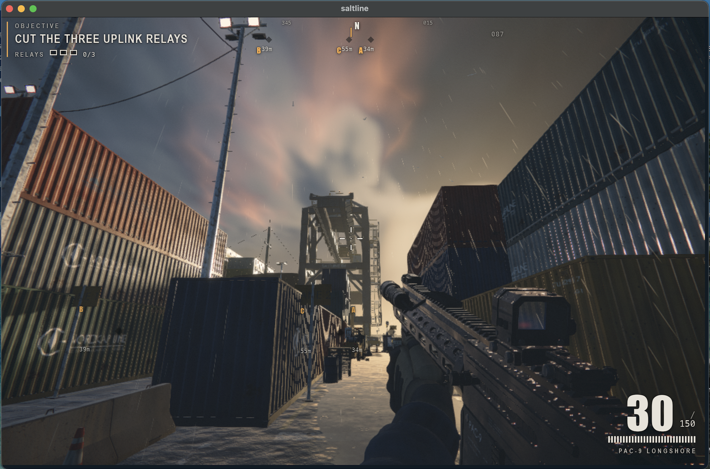

# Saltline · xbintsc

> 由一条提示词生成的浏览器 FPS，现在是一个原生桌面程序。

[](https://github.com/zy445566/xbintsc)
[](#许可)

**简体中文** | [English](README.en.md)



**Saltline** 是一个单关第一人称射击游戏：暴雨夜，你作为 Port Authority 破袭小队唯一的队员，潜入 Saltline 集装箱码头，切断「Harbormaster」的三座上行链路中继，然后赶到码头南端登船。无人机（Gull）和机器狗（Hound）会一路追杀你。

这个仓库是它的**非官方原生桌面移植**，使用 [xbintsc](https://github.com/zy445566/xbintsc) 构建。它不是 Electron 或 WebView 套壳：窗口、DOM/CSS、WebGL 2、Canvas 2D 与 WebAudio 都由 xbintsc 的 `gui` 扩展提供；整个游戏（66 个 ES 模块，含 three.js r180）在构建期被 AOT 编译进可执行文件。运行时没有浏览器，也没有 JavaScript 引擎。

`assets/` 只是构建输入。最终产物是一个约 24 MB 的单文件程序，几何、贴图、音效全部在启动时程序化生成。

## 游戏内容

- **任务**：三座中继分别是 A（货场 Yard）、B（仓库 Shed）、C（码头 Quay）。靠近后按住 `E` 2.4 秒即可切断；每切断一座都会触发一波敌人。三座全断后，目标变为「Get to the boat」，接应船在南端码头等待。
- **敌人**：Gull 是空中无人机，Hound 是地面步行机；Hound 的头部有弱点判定，命中弱点与击杀会在 HUD 上单独提示。
- **武器**：PAC-9 Longshore，30 发弹匣、150 发备弹、720 RPM；支持右键瞄准、换弹、近战和移动射击。
- **场景**：约 80 × 60 米的集装箱堆场，包含龙门吊、货轮、积水反射、雨、体积雾和黄昏天空；没有外部模型或贴图文件。
- **声音**：全部由 WebAudio 合成，音乐强度会随战斗状态变化。
- **HUD 与流程**：罗盘目标标记、中继计数、生命值、弹药、击杀提示、无线电字幕，以及标题、暂停、死亡和结算界面。结算会按用时、命中率和重试次数给出 `Messy` 到 `Surgical` 的评级。
- **设置**：画质（自动/低/中/高/极高）、鼠标灵敏度、Y 轴反转、音量、FOV，保存在 `localStorage` 的 `saltline.settings.v1` 中。

## 快速开始

### 环境要求

- **Node.js 22+**：只在构建时需要，生成的可执行文件不依赖 Node
- **clang 16+ 工具链**
  - Windows 11+：Visual Studio C++ 生成工具（含 MSVC、MSBuild 和自带的 LLVM）
  - macOS 11+：Xcode Command Line Tools（`xcode-select --install`）
  - Linux：`clang` 与 `lld`（预编译运行时面向 glibc 2.39+）
- **可用的 GPU 驱动**：GUI 引擎通过 SDL_GPU 渲染，Windows/Linux 使用 Vulkan，macOS 使用 Metal

### 构建与运行

```bash
npm install
npx xbintsc doctor   # status 显示 ok 即可
npm run build
```

Windows：

```powershell
.\build\main.exe
```

macOS / Linux：

```bash
./build/main
```

`npm run build` 等价于 `npx xbintsc build`，参数来自 `xbintsc.config.json`（入口 `main.ts`、输出 `build/`、扩展 `gui` 与 `node`、应用名 `saltline`），不需要额外命令行参数。

首次构建需要生成约 82 MB 的 LLVM IR，再由 clang 编译并链接 C 运行时；之后的构建走 `.xbintsc/` 内容寻址缓存，通常只需几秒。需要强制重编时：

```bash
npm run build -- --force
```

只想编译并直接运行：

```bash
npx xbintsc run main.ts
```

### 构建产物（Windows x64 参考）

| 文件 | 大小 | 说明 |
| --- | ---: | --- |
| `build/main.ll` | 82.5 MB | xbintsc 生成的 LLVM IR |
| `build/main.o` | 19.9 MB | clang 目标文件 |
| `build/main.exe` | 24.6 MB | 自包含可执行文件 |

`build/`、`.xbintsc/` 和 `node_modules/` 都在 `.gitignore` 中。

## 项目结构

| 路径 | 作用 |
| --- | --- |
| `main.ts` | xbintsc 入口：创建 1200 × 960 窗口、设置背景色、加载 `index.html`，然后进入主循环 |
| `index.html` | 页面骨架：`<canvas id="view">`、HUD 容器 `#ui` 和启动遮罩 |
| `assets/` | 游戏的前端构建产物（JS、CSS 与 source map） |
| `fonts/` | Web 构建使用的 WOFF2 字体（原生版会回退到系统字体，见下） |
| `screen/start.png` | 游戏截图 |
| `xbintsc.config.json` | 编译入口、输出目录、扩展和应用名 |
| `build/` | 构建输出（已忽略） |
| `.xbintsc/` | 增量编译缓存（已忽略） |

## 操作

| 动作 | 按键 |
| --- | --- |
| 移动 / 视角 | `W` `A` `S` `D` / 鼠标 |
| 开火 / 瞄准 | 左键 / 右键 |
| 换弹 | `R` |
| 切断中继 | 靠近后按住 `E` |
| 跳跃 / 冲刺 / 蹲下 | `Space` / `Shift` / `C` 或 `Ctrl` |
| 近战 | `F` |
| 暂停 | `Esc` 或 `P` |

鼠标锁定不可用时，游戏会自动切换为拖拽视角：按住鼠标拖动观察，方向键或 `I` `J` `K` `L` 转向，`Enter` 开火。原版的手柄和触屏布局也保留在代码里，是否可用取决于平台与输入设备。

## 实现原理

```text
main.ts ──► xbintsc ──► LLVM IR ──► clang ──► build/main(.exe)
   │
   └─ import page from "./index.html"
         └─ <script type="module" src="./assets/index-Cl0SInxA.js">
               └─ 66 个 ES 模块（游戏逻辑 + three.js r180）
```

- `main.ts` 只负责窗口和 `loadHTML`，游戏本身仍然用 Web 技术编写。
- 构建时，xbintsc 的 HTML 资源加载器读取 `index.html`，找到外链的 ES module，把整张模块图编译成 LLVM IR，再交给 clang 生成可执行文件。`<script>` 里的逻辑最终以原生指令运行。
- `gui` 扩展在运行时提供 DOM/CSS 布局绘制、Canvas 2D、WebGL 2（GLSL 经 glslang 编译为 SPIR-V，macOS 上再交叉编译为 MSL）以及 WebAudio。
- `node` 扩展在配置中启用，用于 Node 内置模块；当前入口没有直接使用。
- 因为所有脚本都在构建期编译，二进制不依赖 `assets/`、`fonts/` 或任何游戏资源目录，可以单独拷走运行。

更多关于语言子集、扩展和 GUI 能力的说明，见 [xbintsc 文档](https://github.com/zy445566/xbintsc#readme)。

## 与浏览器版的差异

GUI 引擎不是浏览器，少数 Web 能力在原生版中有差异：

- **CSS**：`mask-image` 渐变、滑杆的 `::-webkit-slider-thumb` 等伪元素、`color-scheme` 等属性会被忽略；功能不受影响，但细节会简化。
- **输入/全屏**：指针锁定和全屏取决于引擎与系统；不可用时游戏会自动使用拖拽视角，并隐藏全屏按钮。
- **启动时间**：关卡、贴图和音频都在启动时生成，第一次进入通常需要几秒，低端机器会更久。
- **GPU**：在无 GPU 的虚拟机、远程桌面或软件渲染环境中，程序可能停在启动画面；请确认已安装可用的 Vulkan/Metal 驱动。

## 修改游戏内容

`assets/` 是打包后的产物，不建议直接改压缩后的 bundle。游戏原始模块可以从上游的模块化版本获取：

- [realskyrin/fps3ademo-saltline](https://github.com/realskyrin/fps3ademo-saltline)：从原始 Claude Artifact 恢复并拆分为 66 个 ES 模块的项目。

改完上游代码并重新构建 Web 版本后，把新的 JS/CSS 放进 `assets/`，同步更新 `index.html` 里的文件名（带内容哈希），再执行 `npm run build`。想先读代码，可以直接看 `assets/index-Cl0SInxA.js.map`：它保留了全部 66 个模块的源码（`sourcesContent`）。

只改窗口尺寸、标题或背景色，直接修改 `main.ts` 就够了。

## 致谢

- **Saltline** 原版由 [Felix Rieseberg](https://github.com/felixrieseberg)（Anthropic）用 Claude Fable 5.2 通过一条提示词生成（2025 年 11 月），并发布为约 1.4 MB 的单文件浏览器游戏（[原始发布](https://claude.ai/artifact/BGY1SztrAYcJQHSsnHHGmp)）。
- 本仓库使用的游戏代码来自 [realskyrin/fps3ademo-saltline](https://github.com/realskyrin/fps3ademo-saltline) 的模块化 Web 版本（[在线试玩](https://realskyrin.github.io/fps3ademo-saltline/)）。
- [three.js](https://threejs.org/) r180（MIT）。
- 字体：Big Shoulders Display、Barlow Condensed、IBM Plex Mono（Google Fonts，SIL Open Font License）。
- [xbintsc](https://github.com/zy445566/xbintsc)（MIT）及其 `gui` 扩展。

## 许可

本仓库的移植代码与构建配置以 MIT 许可发布（见 `package.json`）。游戏、three.js 和字体分别遵循其上游许可。
